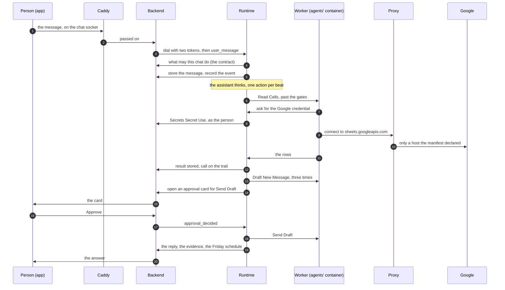

# 3. One request, end to end

## The journey of a sentence

This section is the map of the paper. It follows one request from the
moment a person types it to the Friday after, and at each step it
names the section that looks closer. Nothing here is explained in
full; everything here is explained somewhere.

> *"Email the three customers whose invoices are overdue, and remind me
> on Friday if any of them hasn't paid."*

Think of it as following a letter through a post office: the counter
where it is handed in, the sorting room, the clerk who checks the
address, the van that carries it out, the receipt that is kept. Each
place can refuse the letter, and each refusal is written down.

## The setting

The agents below are real ones, from the public catalog of agents
written for DecentAI. How the organization uses them is illustrative.

- The organization has approved two agents: **Google Sheets**, which
  reads and writes live spreadsheets, and **Gmail**, which reads mail,
  prepares drafts and sends them.
- The person has been given both, and has connected their Google
  account once, by signing in.
- The invoices are kept in a spreadsheet called *Invoices*, one row
  per invoice, with the customer's address and whether it is paid.
- The chat is at **trust level 1**, the standard one: reads and
  ordinary changes run, and anything wider or outside the platform
  asks first.

Every function of an agent carries a level from 0 to 3, written in its
manifest and read by an administrator before approval. The four this
request uses:

| Function | What it does | Level | At trust level 1 |
|---|---|---|---|
| Google Sheets · Read Cells | reads rows from a tab | 0 | runs |
| Gmail · Draft New Message | prepares an email as a draft; nothing is sent | 1 | runs |
| Gmail · Send Draft | sends a prepared draft | 3 | waits for the person |
| (the assistant's own) schedule | sets a reminder | — | runs, and is shown |

## The whole path at a glance

## Step by step

**1. The words leave the app.** The person presses send. The app
puts the message on a socket — a connection that stays open — to the
platform's one public door, **Caddy**, which passes it to the
**backend**. The backend checks who is speaking, that a browser asking
was sent by the platform's own web app and not by another site, that the chat is theirs, and that they may send
messages in it. A message of more than 256 KB is turned away here,
before anything is kept. *[Section 4](04-who-you-are.md) looks closer.*

**2. The backend calls the runtime.** The **runtime** is where the
assistant lives. The backend dials it for this chat carrying two
tokens: one that proves *this is the backend*, and one that says *act
for this person, in this chat*. Neither says what the person may do.
*Sections [2](02-the-idea.md) and [4](04-who-you-are.md).*

**3. The runtime asks what this chat may do.** Before the assistant
thinks a word, the runtime asks the backend: which agents may this
chat use, which functions of them, at what trust level, with which
model? The answer is called the **contract**. The runtime cannot
decide it for itself, and it is asked again with every new message and
every reminder that comes round, so
a permission taken away this morning is gone from this turn.
*[Section 4](04-who-you-are.md).*

**4. The message is kept, then heard.** The message is stored, the
app is told it arrived, and an entry is written in the chat's inbox.
Only then is the assistant given it. If the runtime stopped at this
moment, the message would be found again when it came back.
*[Section 5](05-the-assistant.md).*

**5. The assistant thinks, one step at a time.** Each step — a
**beat** — is one call to the model and one action back: *make a
plan*, *open this agent*, *call this function*, *say this*. Here the
assistant sets a plan the person can see (find the overdue invoices;
draft three reminders; send them; set the Friday reminder), opens the
Sheets agent to see its functions, and proposes a call: Read Cells on
the *Invoices* tab. If the organization had many agents, the assistant
would first search them by meaning; with few, they are already listed.
*[Section 5](05-the-assistant.md).*

**6. The gates.** The proposal is only text. The **executor** checks
it in a fixed order: the function exists in the approved manifest; this
chat has been granted it; its inputs match the manifest's description
of them; and its level is at or below the chat's. Read Cells is level
0, so it runs. *Sections [5](05-the-assistant.md) and [7](07-agents.md).*

**7. The agent's code runs in a locked room.** The Sheets agent's code
runs in a separate container, in a process of its own, as a user that
exists only for that agent, fenced into its own files. *[Section 8](08-the-sandbox.md).*

**8. A credential, handed over for the call.** To read the sheet, the
code needs the person's Google access. It asks the runtime; the
runtime checks that this function declared it would need that
credential, then asks the backend for it, as the person. The backend
writes down that it did, and hands over what the credential is made
of. Here it is a connected account, so that is only a short-lived
access token: the refresh token, which can make new ones, never leaves
the backend. A credential a person typed — an API key, a password — is
handed to the agent's code as it is. Either way it is never shown to
the model.

The agent's code holds what it is handed during the call, and since
its process is kept running between calls, code that wanted to could
keep it. For an access token that is bounded by its expiry, about an
hour; for a typed key it is not. Reading the agent before approving it
is the control for that. *Sections [7](07-agents.md),
[8](08-the-sandbox.md), [9](09-secrets-and-data.md) and
[11](11-what-it-does-not-do.md).*

**9. Out through one door.** The agent's code connects to Google
through the platform's **proxy**, the only way out of its room. The
proxy lets it reach the hosts its manifest declared — for Sheets,
`sheets.googleapis.com` and `www.googleapis.com` — and nowhere else.
*[Section 8](08-the-sandbox.md).*

**10. The result is kept, checked and recorded.** The platform never
sees what passes between the agent's code and Google: the proxy only
carries the bytes, which between the code and Google are encrypted end
to end. What it checks is
the agent's answer to the call — the rows the function returns. Those
are checked against the outputs the manifest declared, and an answer
that does not match is refused as an error. Only then are they stored
in the chat's own storage, and the call is written on the audit trail:
which agent, which function, with what, how it ended, how long it
took, and which hosts it reached. Then the assistant is shown the
rows. Its standing instructions say that what a result carries is
data about the world, and that orders come only from the person's own
messages. *Sections [6](06-nothing-invented.md) and [10](10-stopping-and-watching.md).*

**11. Three drafts.** The assistant finds three overdue rows and calls
Draft New Message three times, once per customer. Each is level 1, so
each runs without asking, through steps 6 to 10 again. Each leaves a
draft in Gmail and a small record in the agent's own storage. Nothing
has been sent.

**12. The send waits for a person.** Send Draft is level 3: it leaves
the platform and cannot be taken back. The chat is at level 1, so the
executor does not run it. It opens an **approval card** instead,
showing the agent, the function, its level and its exact inputs, and
waits. If the person is not looking, they are notified. When they
press Approve, the decision goes to the backend, is recorded, and only
then reaches the runtime, which runs that exact call. Three sends,
three cards. *[Section 5](05-the-assistant.md).*

**13. The answer, and what stands behind it.** The assistant writes
its reply. Beside its words, the app shows only what real calls
proved: a table it chose to show is drawn from the stored rows, not
retyped by the model; each successful change is marked as verified.
If Gmail does not confirm a send, the agent reports the outcome as
*unknown*, and nothing claims it was sent. *[Section 6](06-nothing-invented.md).*

**14. Friday.** The assistant puts a reminder on the chat's **clock**:
on Friday morning, wake up and check. The app shows that it is set,
and the Schedules page lists it. On Friday the clock wakes the
assistant, which reads the sheet again (level 0, so no card) and
writes in the chat which customer has still not paid. That message is
posted in the chat like any other. If nobody has the chat open, the
platform itself — not the mail agent — tells the person, by a push to
their phone or browser, or by an email from the platform when no
device was reached. That is no agent call, so there is no card.

The wake runs at the chat's trust level like any turn, even though
nobody started it. If the assistant decided on Friday to email the
customers again, Send Draft would still be level 3, and the call
would wait on a card for the person's yes.
*Sections [5](05-the-assistant.md) and [10](10-stopping-and-watching.md).*

**15. The record.** Afterwards, the trail holds a line for every call
— the read, the three drafts, the three sends, Friday's read — each
with what it was given, how it ended and which model asked for it,
beside the backend's own lines for each card opened and answered and
each credential lent. Nobody can change them through the platform.
*[Section 10](10-stopping-and-watching.md).*

## Where it could have been stopped

Every step above is also a place the request could have been refused.
That is the point of following it.

| If… | It stops at | And the person sees |
|---|---|---|
| the message is sent by another site | step 1 | nothing reaches the chat |
| the person may not use Gmail | step 3 or 6 | the assistant says it cannot |
| the model invents an input the manifest does not allow | step 6 | nothing runs; the model is told why |
| the agent's code tries to reach another site | step 9 | the connection is refused, and recorded |
| the person presses Deny | step 12 | the email is not sent; the model is told |
| the person presses Stop | any step | the work ends where it stands |

<b>For the specialist</b>: the path in the code, in order

The path from the app to an agent is also described in
[the architecture page](../system/architecture.md#one-message-from-the-page-to-an-agent-and-back);
this is that path for the example, checked against the source.

1. **Browser socket.** `WS /chats/{chat_id}` reaches `chat_websocket`
   (`backend/server/routes/ws.py`) through `frontend/Caddyfile`'s
   `@backend` matcher. `verify_request_auth` refuses a cookie whose
   `Origin` is not the deployment's (a request with no `Origin` is
   taken as not cross-site); the principal must be a person; the chat
   must be theirs (`ChatStore.for_identity`) and not archived. On
   `AI:Chat:Input`: `ai:chat:sendmessage`, then
   `USER_TEXT_MAX_BYTES` (262,144, `contracts/chat.py`), then
   `input_error` (protocol version, `client_message_id`, at most 20
   file parts). The frame becomes the door's `user_message`.
2. **Dial.** `RuntimeClient.connect`
   (`backend/api/services/chat_session/relay.py`) refuses a person who
   stopped everything, then mints a service token (RS256, 60 s,
   `identity/service.py`) and a delegation (HS256, 3,600 s, a
   `runtime_sessions` row, `identity/delegation.py`). The runtime's
   `chat_socket` (`ai_runtime/door/socket.py`) verifies the first with
   the public key, requiring `exp`, `iat`, `nbf`, `jti`, `sub`, issuer,
   audience and `typ` (`ai_runtime/door/auth.py`), and closes with
   4401 before accepting otherwise. The delegation is opaque to it.
3. **Contract.** `SessionHost.session` builds a session once per chat
   under a lock (`ai_runtime/door/host.py`), reading `AI:Chat:Contract`.
   Each later `user_message` re-reads it (`SessionHost.refresh`)
   *after* the message is stored and *before* the mind is given it, and
   so does each clock wake. A decision on a card does not re-read it.
   A re-read that fails leaves the last contract in force. Every call
   back passes `AccessController.is_allowed`: `RUNTIME_ENDPOINTS`
   first, then the person's policies.
4. **Kept, then heard.** `Session.deliver_user`
   (`ai_runtime/chat/session.py`): `AI:Message:Create` (a resend with
   the same `client_message_id` is the same message), the
   `message_created` frame, the contract refresh, `AI:Event:Record`
   (the inbox, with a sequence number), then the post to the mind.
5. **Beats.** `Assistant._beat` (`ai_runtime/mind/assistant.py`). The
   model is offered the action vocabulary and each opened agent's
   functions as tools carrying the manifest's input schema; one action
   is taken per beat. `invoke` is refused before the executor if the
   agent is not open (`Assistant._gate`). Functions are named
   `agent.capability.function` with the agent's approval ref (`agt_…`)
   in the first place; "gmail" here stands for that ref.
6. **Gates.** `FunctionExecutor._gates`
   (`ai_runtime/execution/executor.py`): declared in the manifest;
   `grants.may_reach`; storage references resolved and defaults
   applied; no NaN or Infinity; input schema; scopes read and held to
   `grants.allows`; then `permission_level` against `chat_level`.
7. **Worker.** `WorkerPool.invoke` (`ai_runtime/agents/pool.py`) finds
   or starts the agent's one worker through the spawner, and sends the
   call on its line ([worker protocol](../reference/worker-protocol.md)).
8. **Credential.** The SDK's `call.resources.use_secret("google")`
   is an ask on the worker's line. `WorkerPool._route` accepts it only
   for a call live on that worker; `ResourceAccess.use_secret`
   (`ai_runtime/execution/resources.py`) requires that the function
   declared `secrets: {google: use}`; `ChatResources.use_secret`
   (`ai_runtime/door/platform.py`) calls `Secrets:Secret:Use` under the
   delegation. The backend decrypts, refreshes the OAuth access token
   if needed and strips the refresh token (`OauthFlow.fresh`,
   `backend/api/services/oauth.py`) — that is the branch
   `_values_for_agent` takes when the secret's definition is OAuth; any
   other secret's values are returned decrypted, as stored — and
   appends `secret.use` to the trail
   (`backend/api/services/data_layer/secrets.py`). The runtime keeps
   nothing past the call; the worker, kept warm, may.
9. **Egress.** `ai_runtime/agents/egress.py`, by the worker's pass;
   [section 8](08-the-sandbox.md) has the order of checks.
10. **Result.** What is checked is the function's return value, sent
    back on the worker's line — never the worker's traffic to Google,
    an HTTPS `CONNECT` tunnel the proxy passes without reading. In
    `FunctionExecutor._execute`, keys only the platform writes
    (`storage_ref`, `displays`, `denied`, `not_permitted`) are stripped
    from it; on success it is validated against the function's
    `outputs` schema (`_validate`, JSON Schema 2020-12), and a mismatch
    becomes an error observation, stored nowhere; the result is
    stored (`AI:Storage:Create`); `_record` writes the `execution`
    event through `AI:Audit:Record` whatever the outcome. An
    observation over 16,000 characters is shown to the model as a
    preview plus its `storage_ref`.
11. **Drafts.** Gmail's `draft.compose` declares `data: {draft:
    [create]}`, so its record is written by the runtime through
    `Data:Record:Create` into the agent's own slot.
12. **Send.** See the next block.
13. **Evidence.** `Evidence` (`ai_runtime/mind/evidence.py`): a
    `success` part ("Verified: …") for each successful call above level
    0; a `table` part only for a stored result the trace holds and a
    declared list field, named by the model in `say.show`.
14. **Friday.** See the block after next.

<b>For the specialist</b>: the send, exactly

- **Opening.** Above the chat's level, `_request_approval` calls the
  chat's `approve` door, `Cards.approve` (`ai_runtime/chat/cards.py`).
  It builds a `ParkedInvocation` from the inputs *as resolved and
  defaulted*, computes `action_hash` — SHA-256 over sorted, compact
  JSON of agent, function and inputs — and opens the card with
  `AI:Approval:Open`, which stores the hash on the record
  (`backend/api/endpoints/app/ai/approval_controller.py`) and writes
  `approval.requested`. The park is saved into the mind's state
  *before* the card is shown; if that save fails, the card is taken
  back and the call reports that the person could not be asked, not
  that they refused. Approval cards do not expire on their own.
- **Deciding.** `AI:Approval:Decide` is a person's action and is not on
  `RUNTIME_ENDPOINTS`. It records the decision, writes
  `approval.resolved`, then sends `approval_decided` with the stored
  hash through the relay.
- **Running.** If the call is still waiting in this process, the
  decision settles its waiter and the same in-memory call proceeds to
  `_execute`. If the process died meanwhile, the session finds the park
  or the waiting job in the hydrated state and calls `resume_invoke`:
  every gate runs again against the grants and manifest as they are
  now, and the recomputed hash must equal the one the backend kept, or
  the call is refused. The hash is checked on that path; on the live
  path the inputs never left memory.
- **What is bound.** The hash binds the call: here, *which draft*
  (`draft_ref`). The draft's words were shown when it was prepared, as
  the inputs of Draft New Message. A draft changed in Gmail between the
  card and the send is sent as it then stands.
- **A Deny** returns a denial observation, and the hosts that call's
  inputs named are refused to every function of that agent for the rest
  of the ask (`Assistant._refused_already`).

<b>For the specialist</b>: Friday, exactly

- **Setting it.** The `schedule` action with a `note` and `at` (ISO
  8601, read in the chat's time zone from the contract) lands in
  `ChatClock.schedule` (`ai_runtime/chat/clock.py`). A `function`
  schedule would run with no model at all and wake the assistant only
  when its `wake_field` came back non-empty, but only a function its
  manifest marks `schedulable`, which must be level 0 or 1 and may not
  use the model (`contracts/agent_manifest.py`). Read Cells is not
  marked so; Gmail's Check For Replies is, which is how *"remind me if
  they haven't replied"* would be done. "Hasn't paid" lives in the
  sheet, so this is a note that wakes the assistant. The row is
  written through `AI:Schedule:Add`, at most 50 per chat, and the app
  hears `schedule_set`.
- **Staying alive until then.** The clock runs in the runtime and
  acts through a delegation, so the backend keeps the dial open for any
  chat holding schedule rows: closing the app does not close it
  (`RuntimeClientManager.release`), the delegation is renewed over the
  socket every 45 minutes (`renew_due`), and every such chat is dialed
  again at boot and on each renewal tick (`redial_scheduled`).
- **Firing.** The clock looks every 30 seconds; an overdue row found at
  start fires once, never as a backlog. The fire posts a `wakeup` event
  to the chat's session, built if none is live, and the contract is
  read again before the wake is delivered, as it is for a message
  (`SessionHost.deliver_event`).
- **The level.** `SessionHost.refresh` re-reads the contract and
  `_adopt` passes its `chat_level` (`_chat_level`) to
  `Session.adopt`, which gives it to the assistant; the assistant
  passes it on every `invoke`, and nothing in the wake path raises it.
  So a Send Draft proposed on Friday parks on a card exactly as the
  first sends did (the previous block).
- **Telling.** The answer is an `AI:Message:Create` like any other.
  When it is written and no browser of the person has the chat open,
  `backend/server/notifications.py` (`assistant_said`) pushes to their
  devices — web push, or Expo's service for the phone app — at most
  every two minutes per chat, and, if no device was reached and they
  have not turned email off, sends an email through the platform's own
  mailer, at most one per chat per ten minutes. No agent is called.

