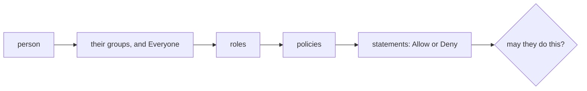

# 4. Who you are, and what you may do

## The badge and the list

Think of an office building.

- **Your badge says who you are, and nothing else.** Which doors it
  opens is written on a list kept at the security desk.
- **Every door asks the desk, every time.** If the desk crosses your
  name off at ten o'clock, the door says no at one minute past.
- **A door with nothing on its list stays shut.** Nobody gets in
  because somebody forgot to write a rule.
- **Several companies share the building, on separate floors.** A badge
  from one opens nothing on another's floor, and its staff cannot even
  see the other company's lists.

DecentAI checks access the same way. When you sign in, your browser is
given a token that *names* your sign-in and says nothing about what you
may do. Every request — a button you click, or the assistant acting for
you — is checked again against the lists as they are at that moment.

## Organizations that cannot see each other

One installation can host several **organizations**. Each has its own
people, lists, data and approved agents. When someone asks for a thing
by its id, the platform looks only inside their own organization, so
naming another organization's record finds nothing. Organizations are
created and switched off by whoever runs the installation, from the
machine itself; one that is switched off keeps its data and lets nobody
in.

## The chain from a person to a permission

Nobody holds a permission directly. A person belongs to **groups**; a
group carries **roles**; a role bundles **policies**; a policy is a
list of **statements**, and a statement is where a permission is
written: *allow these actions*, or *deny these actions*.

So "why can this person do that?" always has an answer that can be
followed and changed. There is no hidden administrator switch: an
administrator is someone whose groups lead to a policy that allows
administrative actions. Three rules decide every answer:

1. **An action is the name of the thing being called.** Placing a user
   into groups is the action `iam:user:set_groups` because that is the
   request's name. No second vocabulary can drift out of step.
2. **Nothing is allowed by default.** No statement that allows it means
   no.
3. **A deny always wins**, wherever in the chain it was written.

**What an organization starts with.** Three groups are made with it:
**Administrators**, whose policy allows everything; **Everyone**, which
every person is in automatically and which carries the *baseline*; and
**Members**, for everyday use — chats, files, saved data, one's own
credentials, and seeing the agents one was given. The baseline is what
would be wrong to withhold: your own profile, what the assistant
remembers about you, stopping your own running work, your own API keys,
notifications and audit trail. Chatting is not in it; it is in Members.
All three are ordinary groups afterwards, which an administrator may
edit. When a release adds a baseline action, each organization is
offered it exactly once, so an action an administrator removed is not
put back.

## Two promises about the lists

**An organization cannot lock itself out.** Delete the policy that lets
anyone manage access, or remove the last administrator, and nobody
inside could ever repair it. So after every change to the chain the
platform asks: *can at least one active person here still place people
into groups?* Whoever can do that can restore everything else. If not,
the change is undone and refused.

**Nobody can grant what they do not hold.** Otherwise anyone who may
write a policy could write themselves a better one. Writing a policy,
attaching it to a role, a role to a group, a person to a group, or
inviting a person into one: every action the change would *allow* must
be one its author already holds. A *deny* is free; it only takes away.

## Who can be "you"

| Caller | Proves itself with | May do |
|---|---|---|
| a person in a browser | a cookie naming a sign-in | what their chain allows |
| the same person in the phone app | the same token, in a header | the same, except make or revoke API keys |
| a script with an **API key** | a long random key | what its person may, except make or revoke keys or change the password |
| the **runtime**, acting for a person in one chat | a *delegation* for that chat | what the person may, *and* on a short fixed list, *and* only in that chat |
| the runtime, as itself | a token only a runtime can sign | download approved agent code; nothing else |

When the assistant acts for you it is never more than you, and usually
much less. It cannot change who is in which group, touch your account
settings, or reach any chat but the one it was opened for — even when
it acts for an administrator.

## In the example

> *"Email the three customers whose invoices are overdue, and remind me
> on Friday if any of them hasn't paid."*

Say the person asking is an employee in Members.

- **They may chat** because Members allows the chat actions.
- **Their chat can use the mail agent** only because someone decided
  so. When an agent is approved for the first time, it reaches only
  the administrator who approved it and that administrator's groups.
  Nobody else can use it until someone grants it to them. Here,
  someone allowed to give access must have added Members, or this
  employee, on the mail agent's page — for the whole agent or only
  some of its functions. Without that grant the mail agent is simply
  absent from the chat.
- **The assistant acts for them through a delegation**: a permission
  slip for this one chat, issued when the chat connects to the runtime,
  lasting an hour and renewed while the chat stays connected (closing
  the app does not withdraw it). With it the
  runtime may put the Friday reminder on the person's clock and read
  their records, because the person may and those actions are on the
  runtime's list. It cannot use the slip in another chat, or to add the
  employee to Administrators.
- **What the chat may ask agents to do is read again** with every
  message and every reminder that comes round. If the mail agent is
  withdrawn mid-conversation, the next message no longer has it.

## Signing in, and staying signed in

**Nobody signs themselves up.** A person joins by invitation; the link
lasts seven days, and the account's address is the one the invitation
went to, because the link proves only that mailbox. Where there is no
mail server, an administrator adds the person and is shown a temporary
password once, which opens nothing until the person chooses their own.

**Passwords** are 10 to 256 characters with a letter and a digit, and
are stored only as a slow one-way hash. **Guessing is slowed down**:
five wrong passwords for one account in fifteen minutes lock it, and
twenty failures from one network address lock the address. While
locked, the right password is refused like a wrong one.

**Sessions live on the server.** The browser holds only a signed pointer
to a record the platform keeps, and every request looks it up. Signing
out, being disabled or a password reset therefore counts on the next
request. A sign-in lasts seven days, or ninety if you ask to be kept
signed in. **A reset link** lives one hour and works once; using it ends
all your sessions and revokes your API keys, since the usual reason for
a reset is that someone else may have had the password.

**API keys** are for scripts. A key is you, checked on every call, and
loses whatever you lose. The platform keeps only a fingerprint and shows
the key once. Keys are made and revoked only from a signed-in browser —
not with a key, not from the phone app, which may list them — so a
leaked key cannot make itself permanent or lock you out.

## What this does not do

- **It does not decide which records you see.** Whether you may list
  records at all is policy; which ones is each record's own sharing.
- **It does not separate people inside an agent.** An agent granted to
  a group serves everyone in it ([section 8](08-the-sandbox.md)).
- **A change made outside the running application** — an organization
  disabled, a password set from the command line — reaches it within a
  minute, not at once. [Section 11](11-what-it-does-not-do.md) lists this with the other limits.

<b>For the specialist</b>: the decision and the cache

### One gate, named by the endpoint

Every application call is `POST /app` with
`{"endpoint": "Domain:Controller:action", "data": {…}}`.
`APIRouter.route` (`backend/api/api_router.py`) splits and lowercases
it, refuses an action beginning `_`, asks `AccessController.is_allowed`
(`backend/server/authentication/access.py`), and only then checks the
string is in the catalog (`ActionCatalog.is_known`), so a controller's
other public methods are unreachable even under a wildcard. Uploads and
downloads go through the same router; the chat socket calls the same
`is_allowed`. Controllers hold no authorization code, only the two
invariants and tenant scoping.

The vocabulary is `ACTION_CATALOG` in
`backend/server/authentication/catalog.py` — a little under two hundred
actions, in code so that widening it is a code review. A policy is
validated on save (`PolicyStore.validate_permissions`,
`backend/database/stores/iam.py`): at most 50 statements of 100 actions,
`resources` only `["*"]`, every action in the catalog or a wildcard
whose text before its first `*` begins a real action
(`ActionCatalog.is_valid_pattern`,
`backend/server/authentication/policy.py`).

### Resolution and evaluation

`PolicyEngine.effective_statements`: the user's `assigned_groups` plus
the organization's Everyone document (`everyone_<org_id>`, implicit,
never stored on the user) → union of their roles → union of those
roles' policies → all statements. `PolicyEngine.evaluate` matches with
`fnmatchcase`; a matching `Deny` returns false at once, a matching
`Allow` sets true and evaluation continues, no match is false. The
effect is compared case-insensitively, so a hand-edited `"deny"` cannot
fail open. Administrators are allowed everything because the seeded
policy is `{"effect": "Allow", "actions": ["*"]}`
(`bootstrap/provisioning.py`), not because of a flag. Stores of
organization-owned documents read caller-supplied ids through
`OrgScopedStore.get_in` / `list_in`, with `org_id` in the query, and
the organization is always taken from the caller's own record
(`IAMController._org`, `backend/api/endpoints/admin/iam/base.py`).

### The access cache

`AccessCache` (`backend/database/stores/base.py`), in process, entries
at most `TTL_SECONDS = 60`:

- **sessions** (session id → principal): dropped for one session on
  logout or when a delegation is replaced, and for all of a user's
  (`drop_user`) when their groups, status, password or email change or
  they are deleted;
- **statements** (user id → statements), stamped with a
  `permissions_version` that any write to a group's roles, a role's
  policies, a policy, or an agent grant increments, staling every entry.

Invalidation lives in the store method that writes, and the backend is
one process (`backend/main.py`), so an in-app change governs the next
request. Another process's writes (`bootstrap/organizations.py`,
`bootstrap/reset_password.py`) are seen when entries expire. Every
write invalidates on both sides of itself (`AccessCache.changing_user`,
`changing_session`, `changing_permissions`), and a resolution carries
the cache generation it began reading at: if an invalidation came in
between, its result is not stored (`put_session` / `put_statements`
with `since`). So a request that read the old rows while a write ran
cannot re-cache them. API keys never enter the session map.

<b>For the specialist</b>: the two invariants

### Lockout

`PolicyEngine.someone_can_manage_access(org_id)`: some `active` user of
*this* organization resolves `iam:user:set_groups`. It runs after the
write; on failure `IAMController._lockout_check` undoes it and answers
409.

| Change | Undo |
|---|---|
| `IAM:User:set_groups` | previous `assigned_groups` |
| `IAM:Group:set_roles`, `IAM:Group:delete` | previous roles, or reinsert the group |
| `IAM:Role:set_policies`, `IAM:Role:delete` | the same, for the role |
| `IAM:Policy:update` (statements changed), `IAM:Policy:delete` | previous statements, or reinsert |

On a deletion the check precedes the cascade that detaches the item, so
the undo is one reinsert. Disabling and deleting a person are checked
*before* the write, with the target excluded, and nobody may disable or
delete themselves. Tests: `backend/tests/test_lockout.py`.

### Grant boundary

`PolicyEngine.ungrantable_actions(author, permissions)` expands each
`Allow` pattern over the catalog and returns the concrete actions the
author does not hold (`allowed_actions`, which applies the author's own
denies). `Deny` statements are not examined. Each edge collects the
policies it would bring in and asks the same question:
`ungrantable_in_policies` (role), `ungrantable_in_roles` (group),
`ungrantable_in_groups` (setting a person's groups, adding a person by
hand, inviting). The whole proposed set is checked, not only what is
new. An administrator's password reset of someone else is bounded by
the target's groups, since taking an account is taking its access. An
invitation is checked when issued, and again when accepted
(`AuthController.accept_invitation`,
`backend/server/authentication/flows.py`), against the inviter as they
are then: found by the `invited_by_user_id` recorded at issue (an older
invitation by `invited_by_email`). An inviter who is gone, in another
organization, disabled, or no longer holds what the groups grant
withdraws the invitation: it is revoked and accepting answers 409,
asking for a new one. An invitation with no groups is not checked.

The boundary covers the IAM chain. **Agent grants are outside it.**
Who may call an installed agent's functions is a separate allow-only
list keyed by the agent (`AgentGrantStore`,
`backend/database/stores/agents/grants.py`), because functions are
discovered from manifests and would rot inside authored policies.
Whoever holds `agents:agent:grant` — in the seeded chain, only
Administrators — may grant any installed agent to anyone in the
organization; a first install grants it to the installer by name and
to their assigned groups (`_grant_on_install`,
`backend/api/endpoints/app/agents/grants_controller.py`). A
re-approval of a version finds a grant already there and adds nothing.

<b>For the specialist</b>: principals, sessions, keys, delegations

### Telling callers apart

`AccessController.verify_request_auth` takes the `access_token` cookie
first. A cookie whose request `Origin` is not the app's own
(`PUBLIC_APP_URL`, `CORS_ALLOW_ORIGINS`) is refused, with no fall-back
to a header: browsers send it to every port of `localhost`. Otherwise
an `Authorization: Bearer` value, and then:

1. `dk_…` is an **API key** (`_api_key_user`), looked up every call;
2. a JWT with header `alg: RS256` is the **runtime as itself**, checked
   against `AI_RUNTIME_SERVICE_PUBLIC_KEY` with issuer, audience,
   expiry and `typ: runtime_service`, and allowed exactly
   `RUNTIME_SERVICE_ENDPOINTS` with no policy read;
3. anything else is HS256 over `TOKEN_SECRET_KEY`
   (`backend/server/authentication/credentials.py`) naming a
   `session_id`: `token_type: RUNTIME` in `runtime_sessions`, otherwise
   in `sessions`.

Both session kinds pass through `_resolve_session`: the row exists and
is unexpired (checked on read, not left to the TTL index), the user
exists and is not disabled, the organization is active; a failure
deletes that user's sessions of that kind. No other claim is read for a
decision. A web session from the cookie is marked `client: browser`,
from the header `client: app`.

**Sessions** (`SessionStore`): 7 days, or 90 with `remember`; the token
is signed for the session's lifetime, the cookie is `HttpOnly`, and an
unremembered cookie ends with the browser
(`backend/server/routes/auth.py`). A native client sends
`"client": "native"` and receives the token in the body.

**API keys** (`backend/database/stores/api_keys.py`): `dk_` plus 32
random bytes; only a SHA-256 is stored (enough at that entropy) and 12
characters for display; twenty live per person; revoking sets
`revoked_at`. `ApiKeyController._from_browser`
(`backend/api/endpoints/app/settings/api_key_controller.py`) admits
`create` and `revoke` only for `token_type: WEB` with `client: browser`;
`list` is not fenced. Disabling the person or completing a reset
revokes all keys; deleting the person deletes them
(`backend/tests/test_api_keys.py`).

### Delegations

`Delegation.for_chat`
(`backend/api/services/chat_session/identity/delegation.py`) replaces
the `runtime_sessions` row for (person, chat) — so an older token names
nothing — and signs a one-hour `RUNTIME` token
(`backend/database/stores/delegations.py`). While the backend's dial for
that chat is open, a one-minute loop hands it a fresh credential once
the current one is 45 minutes old (`RuntimeClientManager.renew_due`,
`backend/api/services/chat_session/relay.py`); a person who pressed stop
gets none. Three layers then apply:

1. **the fence**: `is_allowed` refuses anything not on
   `RUNTIME_ENDPOINTS` (40 actions) before reading the policy; identity,
   account, transfers, authoring and chat administration are off it;
2. **the person's own policy**;
3. **the chat**: chat-scoped controllers refuse a chat other than the
   delegation's `chat_id` (`_runtime_chat`,
   `backend/api/endpoints/app/ai/base.py`), and stored results are read
   from that chat only. Actions not about a chat, such as reading the
   person's records, are bounded by layers 1 and 2.

What agents may be asked is not on the delegation: it is the contract
(`SessionContract._agents`,
`backend/api/services/chat_session/contract.py`) — installed agents ∩
grants reaching the person ∩ the chat's narrowing — read when the
session is built, on each message and on each clock wake.
Logging out does not end a delegation; deleting the chat, disabling or
deleting the person, or their stop-everything switch deletes its rows,
and a disabled organization's are refused by `_resolve_session`.

### Passwords and recovery

All in `backend/server/authentication/flows.py` and
`backend/server/authentication/credentials.py`. bcrypt, cost 12, over
base64(SHA-256(password)), so the 72-byte limit never truncates; an
unknown address is verified against a dummy hash, costing the same as a
wrong password and answered identically. `LoginThrottle`: fifteen-minute
windows from the first failure, `acct:` capped at 5 and `ip:` at 20,
consulted before the password; success clears the account counter, not
the address's; a reset request also spends the address's budget. Only
after a correct password does the answer say the account is disabled,
or that a handed-over password must be replaced (`change_required`, no
session). Invitation and reset tokens are 32 random bytes stored as
SHA-256; one reset link per person, at most one mail a minute, sent on
its own thread so response time reveals nothing. Changing one's own
password needs the current one and ends every session, this one too,
but leaves API keys alone.

