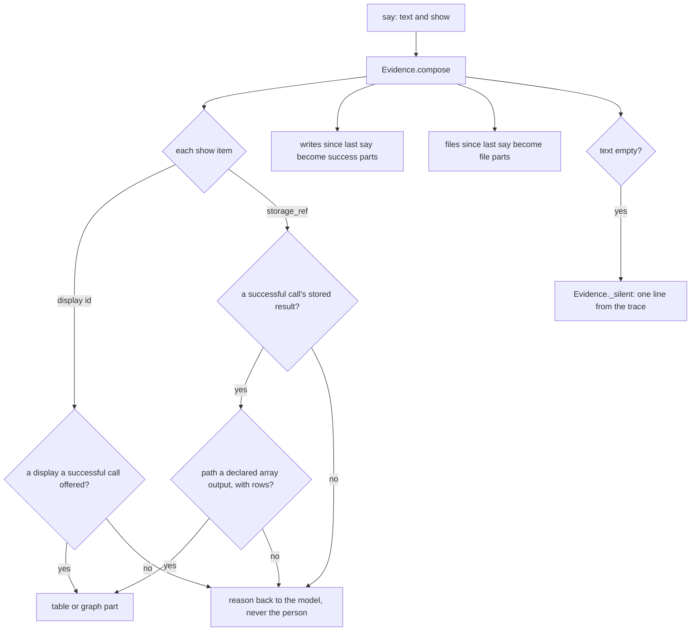

# 6. Nothing invented

## Two voices, kept apart

[Section 2](02-the-idea.md) said that a language model sometimes states something false
with complete confidence. No amount of prompting removes that. So the
platform does not try to make the model's words trustworthy. It does
something narrower that it can actually keep: it makes sure that
**anything shown to you as data was read from a real result**, and not
typed by the model.

Think of a courtroom. A lawyer may say whatever they like in their
argument — that is their speech, and the jury knows it. But an
**exhibit** — the contract, the photograph, the bank statement — is not
something the lawyer writes. It comes from the evidence room with a
label on it. The lawyer may choose which exhibit to hold up, and may say
what they think it means. They cannot change what is on it.

A DecentAI reply is built the same way:

- **The words are the model's.** They travel as written, and they can
  be wrong.
- **What sits beside the words is the platform's.** A table, a chart, a
  file to download: each is an exhibit, taken from the record of what
  actually ran, and each says which agent it came from.

## What may appear beside the words

There are four kinds of thing, and each has a rule.

1. **Tables and charts** appear only when the model asked to show one
   *and* the record proves it is real: it must be the stored result of a
   call that succeeded in this conversation, and the part of it shown
   must be a list the agent declared it returns. The app then fetches
   the rows from storage. The model chooses the title and which columns
   to show; it never supplies a value.
2. **Files** appear when a call in this piece of work created one, as
   the agent's own declaration of its outputs says. The model does not
   name them; it cannot attach a file that was not produced.
3. **Writes** — a record saved, an email sent — are written down with
   the message as quiet marks the app keeps but does not draw. They
   are there for whoever audits the conversation later, not as a second
   voice in it.
4. **A line of the platform's own** appears only when the model said
   nothing at all. Then the platform says, in one plain line, what the
   record shows: what was done, how many results came back, or that
   nothing worked and why.

And a claim with nothing behind it? It is shown as what it is: the
model's words, with no exhibit beside them. The platform does not
decorate it, and does not mark it as verified.

## In the example

> *"Email the three customers whose invoices are overdue, and remind me
> on Friday if any of them hasn't paid."*

The sheet agent's lookup returns the overdue invoices. The model reads
them and writes: *"Three invoices are overdue; the oldest is 41 days
late."* Beneath that sentence sits a table of the three invoices —
customer, amount, due date. The model asked for that table by naming
the stored result and the columns it wanted. The platform checked that
the result was a real, successful call and that *invoices* is a list
the sheet agent declares, and the app drew the rows from storage.

If the model had misread an amount in its sentence, the table would
still show the right one, because the table never passed through the
model's hands. And if the model had tried to show a table from a call
that never happened, or that failed, nothing would be drawn; the model
would be told why, and the person would see only its words.

When the three emails go out, each send is recorded with the message
that reports it, as a write that succeeded. The plan's item *email the
three customers* shows done, and behind it are the three sends that
prove it ([section 5](05-the-assistant.md)). Had the assistant marked it done with nothing
behind it, the plan would say *done · unverified*.

## A ticket, not a copy

Every result of a call that succeeds is kept in the chat's own
**storage**, under a **reference** — like a coat check: you hand over
the coat and get a ticket.

That ticket changes how work flows.

- **The app shows the coat, not a description of it.** A table is
  drawn by fetching the stored rows by their ticket.
- **The next call can take the ticket.** If the mail agent needs the
  list of overdue invoices, the model passes the reference, and the
  platform swaps in the stored list just before the call is checked
  and run. The model never retypes the list, so it cannot mistype it.
- **Big results stay out of the way.** A result of a thousand rows is
  stored whole; the model is shown as much as fits in one step, and a
  note saying how much more there is and how to read it. It does not
  have to read every row to pass them on or to show them.

The last point is also about cost. Every character the model reads or
writes is paid for, in money and in time, and a long result copied
through the model twice — once to read it, once to write it out again —
is paid for twice and is twice as likely to come back changed.

## Checked before it is believed

"From a real result" would mean little if the result could be anything.
First, what "result" means here. The platform never sees the traffic
between an agent's code and the service it talks to — Google, say. The
proxy carries those bytes without reading them; to Google they are
encrypted end to end.
The result is the agent's *answer to the call*: what its function hands
back to the platform when it is done. That answer is checked against
the outputs the agent's manifest declared **before** it is stored,
before the model is shown it, and before anything is shown from it.
An agent that says it returns a list of invoices and returns something
else gets an error, not a table. The few fields only the platform may
write on a result — where it was stored, what it offered to show — are
removed from what the agent returned, so an agent cannot forge them.

## What this does not promise

- **It does not make the model's words true.** A sentence can still be
  wrong. What the design does is make the sentence easy to tell apart
  from the data, and put the data where the model cannot alter it.
- **It does not make an agent's data true.** A result is checked for
  its *shape*, not its truth. If the sheet itself is wrong, the table
  is faithfully wrong.
- **The model still chooses.** It picks which result to show, the
  title, and the columns. A misleading title on a correct table is
  possible.
- **An agent may speak for itself.** An agent can post a message of its
  own into the chat. It appears under the agent's name, as the agent's
  words, not as data the platform vouches for.

<b>For the specialist</b>: how a message is composed

### One function decides what rides beside the words

Every `say` goes through `Assistant._say`
(`ai_runtime/mind/assistant.py`), which calls `Evidence.compose`
(`ai_runtime/mind/evidence.py`) with two slices of the trace:

- **the work since the last say** — `trace[evidence_cursor:]` — for
  writes and files: each piece of work is presented once, by the say
  that follows it;
- **the whole trace** for `show`, so the model may show a result it
  read before an earlier say.

Only trace entries with `status: "success"`, a dict result, and a
function the agent's manifest declares are evidence of anything
(`Evidence._successes`). The prose is never parsed.

`Evidence.compose` takes a `say` and builds its parts. Each `show` item
names either a display a successful call offered, or a successful
call's stored result with a path to a declared array output that has
rows; either becomes a table or graph part, and anything else becomes a
reason sent back to the model, never shown to the person. Writes since
the last say become success parts, files become file parts, and an
empty text gets one line drawn from the trace (`Evidence._silent`).

### Shows

`Evidence.shown`: at most 3 per message (`SHOW_MAX`; extra items are
dropped and the model told), each either `{display, title?}` or
`{storage_ref, path?, title?, columns?}`. For a storage ref, the entry
must be a successful call whose result carries that `storage_ref`; the
`path` must be an output property the manifest declares with
`type: "array"` (inferred when there is exactly one) and must hold a
non-empty list in the result. The part is
`{type: "table", text: title[:120], storage_ref, path, columns[:24],
source}`. A display (`call.show.table` / `call.show.chart`, see
`ai_runtime/execution/call.py`) is accepted only if a successful call's
result lists it; it becomes a `table` or `graph` part. Each refusal
reason goes back to the model as `{"said": true, "not_shown": [...]}`.

The web app (`frontend/src/app/pages/app/ai/chat/chat-detail/chat-detail.component.ts`,
`hydrateStoragePart`) reads the rows with `AI:Storage:Get` under the
person's own session, walking `path` as a dot-path, and keeps only the
model's columns that occur in the rows. The title is the one value in
the part that the model wrote.

### Writes, files, and the silent line

`Evidence.writes`: every successful entry whose function's
`permission_level` is not 0 becomes
`{type: "success", text: "Verified: <function name>", storage_ref?,
source}`. The web app keeps these parts and does not render them
(`frontend/src/app/pages/app/ai/chat/chat-message/chat-message.component.html`
draws `markdown`, `table`, `graph` and `file`).

`Evidence.files`: for each successful entry, every output field (at the
top level, or in each row of a declared list of objects) whose schema
carries `x-resource: {type: "file"}` and holds a non-empty ref becomes a
`file` part, once per ref, with the `filename` the result gave beside
it.

`Evidence._silent` speaks only when the say's text is empty: `Verified:
<names>.` when there were writes; else `Found N results.` (or that the
search came back empty) for level-0 reads with declared list outputs;
else how many calls ran and came back; else `No verified result came
back` with the first error. Where some calls failed beside others that
worked, it adds how many and the first error. A say with neither text
nor parts is refused as an observation, never sent.

### When the platform refuses a part

The backend validates every part against `contracts/chat.py`
(`MarkdownPart`, `FilePart`, `StoredPart`, `SuccessPart`, all
`extra="forbid"`) and refuses a message whose parts do not fit
(`invalid_parts`). `_say` then sends the words alone and tells the model
its parts were refused; if nothing at all could be sent, it rolls
`evidence_cursor` back, so the work is still owed to the next say. The
words are never lost to a bad part, and a part is never sent without
having passed `compose`.

<b>For the specialist</b>: storage, references and output validation

### The order inside the executor

After the gates ([section 5](05-the-assistant.md)), `FunctionExecutor._execute`
(`ai_runtime/execution/executor.py`):

1. refuses to run a function whose declared `inputs` or `outputs` is not
   a valid JSON Schema — so a function cannot do its writes and only
   then fail validation;
2. runs the call in the agent's worker, under its timeout; what comes
   back is the function's return value on the worker's line — the
   worker's own connections out pass through the proxy, which checks
   the host and does not inspect what is sent (an HTTPS connection is
   a `CONNECT` tunnel it cannot read);
3. strips `PLATFORM_KEYS` — `storage_ref`, `displays`, `denied`,
   `not_permitted` — from what the worker returned;
4. validates the result against the declared `outputs` (Draft 2020-12,
   with an empty reference registry); a mismatch turns a success into
   an error: `returned output not matching its manifest`. A function
   that declares no `outputs` is not checked here — and then declares
   no list either, so nothing of its result can be shown as a table;
5. only then stores it (`sinks.store` → `AI:Storage:Create`) and adds
   the `storage_ref`, then the `displays` the call offered.

Storage is "audit-plus-reference, not authority": if storing fails, the
result stands without a ref — and, without one, cannot be shown as a
table or named as plan evidence. The backend caps one stored result at
8 MB (`backend/api/endpoints/app/ai/storage_controller.py`).

A display is checked when the agent offers it (`display_stored`,
`contracts/chat.py`): a table of at most 500 rows of plain cells and 24
columns, or a bar, line or pie chart of at most 8 series and 200 points
with one value per label, at most 256 KiB, no NaN; at most 5 per call.
It is stored at once, and its `display_id` is its storage ref. Its rows
are the agent's computation; what the platform proves is that the call
that offered it succeeded.

### References in, without the model

`FunctionExecutor._resolve_references`: before defaults and schema
validation, each **top-level** input of the form `{storage_ref, path?}`
is replaced by the stored value (`sinks.read_result` →
`AI:Storage:Get`). Under a runtime delegation the backend scopes that
read to the delegation's own chat, so a ref from another conversation
resolves to nothing. The function then validates and runs on the real
values. A helper's storage is its parent conversation's, so refs named
in a helper's goal resolve. The approval card shows, and the action
hash binds, the inputs *after* resolution — the person approves the
values, not a ticket.

### What the model is shown, and what the trace keeps

`Assistant._record`: the model's observation is the result whole up to
16,000 characters; beyond that, a preview of whole list items within
12,000, the `storage_ref`, the `displays`, and a note giving the counts
and how to page with `read {storage_ref, path, from}`
(`ai_runtime/mind/observations.py`). The trace keeps a copy cut to
4,000 characters, lists still lists; for a cut copy the row counts and
every file the result made are read off the whole result first and kept
on the entry (`counts`, `files`), so the silent line and file parts
stay exact.

The trace is bounded (`AssistantState.compact`, `ai_runtime/mind/state.py`):
the newest 100 entries stay, and older ones are dropped only after a
say presented them. A `show` is checked against the trace the mind
still holds, so a result older than that window is refused as unproven
even though storage still has it; the model can call again.

### Plan evidence

A plan item's evidence is limited to what `Acts.proven()`
(`ai_runtime/mind/acts.py`) returns: storage refs of successful trace
entries, and ids of jobs that ended `done`. Refs are attached
automatically to items in progress when a call succeeds; a ref the model
names that is not in that set is refused. A helper's items settle `done`
with its job id and its calls' storage refs only when it reported
`completed` and at least one of its calls succeeded
(`Children._settle_owned`, `ai_runtime/mind/children.py`).

### What is enforced, and what is only asked

Enforced in code: which parts exist; that a table, chart or file comes
from a successful, manifest-declared, schema-checked result; that the
rows are drawn from storage; that writes and files are derived, not
named; that plan evidence is a real ref. Asked of the model in the
prompt (`ai_runtime/prompts/assistant.md`), and not enforced: not to
repeat the shown rows in its prose, and never to claim that an action
succeeded unless an observation confirmed it. The second is exactly the
gap this section names: the words are the model's.

