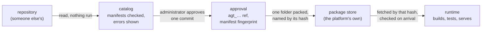

# 7. Agents: a contract before code

## The permission screen, but stricter

When you install an app on a phone, it shows you a list: *this app
wants your camera, your contacts, your location*. You say yes or no.
After that, the phone holds the app to some of what you agreed, and
trusts it about the rest.

An agent in DecentAI comes with a list of the same kind, called its
**manifest**, and the platform is stricter about it in four ways.

- **The list is longer and exact.** It names every action the agent
  can perform, the precise shape of what each one takes and gives
  back, how serious each one is, what the agent keeps, what kind of
  password it needs, and every website it will connect to.
- **Someone reads it before any of the agent's code runs** — once,
  when an administrator decides whether the organization should have
  this agent at all.
- **What is approved is one exact version of the code**, kept by the
  platform itself. If the author changes it afterwards, nothing
  changes here until someone approves again.
- **The agent is held to the list on every single call.** An action
  the list does not name does not exist. An answer that does not match
  the promised shape is thrown away.

So the manifest is a contract, and it comes before the code.

## What an agent is

An agent is a folder in a git repository: a file called
`manifest.yaml`, and the agent's code, in Python. One repository may
hold many agents, listed in a catalog file at its root. The manifest
declares:

| What | For the Gmail agent |
|---|---|
| **who it is**: id, name, version, description | `gmail`, "Gmail", version `0.3.2` |
| **what it can do**: tools, each holding functions | the tool `draft` holds `reply`, `compose`, `send`, `discard` |
| for each function, **what goes in and comes out**, as a precise shape | `send` takes one `draft_ref`; it returns `sent` and a `status` of `sent` or `unknown` |
| for each function, **how serious it is**, a level from 0 to 3 | `send` is level 3: it leaves the platform |
| **what it keeps**: kinds of records and files, with their fields | `draft`, `watch` and `inbox` records; `attachment` files |
| **what credential it needs**, by shape, never by value | a Google account, connected by signing in |
| **where it connects** | `gmail.googleapis.com`, nothing else |
| **what it needs installed** | `requests` |

The levels are [section 5](05-the-assistant.md)'s: 0 only reads, 1 makes an ordinary change,
2 a wider change inside the platform, 3 reaches outside it. A function
above the level a chat allows waits for a person's yes.

A manifest that does not say where its agent connects is refused. An
agent that connects nowhere says so with an empty list; silence is not
an answer the platform accepts.

## In the example

Our request needs an agent that knows which invoices are overdue, and
one that sends mail. Both exist in the published agent repository, and
what follows is trimmed from their real manifests. Where the invoices
live is our choice for the example: a Google spreadsheet, read by the
Google Sheets agent. (Had they arrived as an uploaded Excel file, the
Spreadsheets agent, which connects nowhere at all, would read them.)

The mail agent's manifest, cut to its bones:

```yaml
agent: {id: gmail, version: "0.3.2"}
network:
  hosts: [gmail.googleapis.com]
resources:
  secrets:
    - id: google                          # connected by signing in
      oauth: {provider: google, ...}
  data:
    - id: draft                           # one record per draft it made
      fields:
        - {name: to,     type: string, storage: keys, required: true}
        - {name: status, type: select, storage: keys, required: true,
           options: [prepared, sent, unknown, discarded]}
tools:
  - id: draft
    resources: {secrets: [google], data: [draft]}
    functions:
      - id: send
        permission_level: 3
        resources: {secrets: {google: use}, data: {draft: [read, update]}}
        inputs:
          type: object
          additionalProperties: false
          required: [draft_ref]
          properties:
            draft_ref: {type: string, x-resource: {type: data, id: draft}}
```

The request's steps, as the two manifests price them:

| Step | Function | Level |
|---|---|---|
| read the invoice sheet | Google Sheets `values.read` | 0 |
| prepare each reminder as a Gmail draft | Gmail `draft.compose` | 1 |
| send each draft | Gmail `draft.send` | 3 |
| remember that a reply is awaited | Gmail `watch.await_reply` | 1 |
| later, check whether anyone answered | Gmail `watch.check` | 1 |

In a chat at the standard level, 1, everything up to the drafts runs
without asking, and each send waits for its own yes. The author split
*draft* from *send* on purpose, so that the step that leaves the
platform is small and separate, and that choice is visible in the
manifest before anyone installs the agent. Whatever runs on Friday with
nobody watching must be a function marked fit to run on a clock, and
such a function may only be level 0 or 1: `watch.check` is marked so;
`draft.send` cannot be.

## From a repository to an approval



1. **An organization names a repository**, a source, and **the
   platform reads it without running anything**. It shows an
   administrator what each agent declares, with its README and the
   names and sizes of its files.
2. **Each manifest is checked as it is read.** One that breaks the
   rules is listed with the reasons, and approval refuses it.
3. **An administrator approves one agent at one exact commit**,
   recorded by its full identifier: the commit the source points to
   at the moment they click, read again then — which may be newer than
   the one they reviewed.
4. **The platform keeps the code itself**: it packs that agent's folder
   into one archive, named by a fingerprint of its exact bytes. A
   repository later deleted, made private or rewritten changes nothing
   the organization runs.
5. **The runtime fetches the archive by that fingerprint and checks
   it** before writing anything; checks the manifest inside against the
   approved one; builds the agent's environment; and starts it once to
   see that its code provides every function its manifest promised.
   Only then does it serve the agent.

An agent ends with two names. The **approval** is called by a
reference the platform makes up, `agt_` and twenty random characters,
belonging to the organization that approved it. The **package** calls
itself what its author wrote, such as `gmail`. Everything outside the
code — who may use it, its records, the audit trail — speaks the
approval's reference, which is what stops one organization from
naming, and so reaching, another's agent.

## Who may use it

Approving an agent does not give it to everyone. On first install it
reaches the installer and the groups they are in, and no further.
Anything wider is a **grant** on the agent: groups or people, and the
whole agent or a list of its functions.

A grant can be narrowed by **scope**. A manifest may say that one of a
function's inputs names what the call is about — a notebook, a
project — and a grant may allow the function only for some values:
*the finance team may use the notebook agent, but only for the finance
notebook*. The manifest decides what a scope means and where it is
read from; the grant decides which values a person is entitled to.

## Held to it on every call

Every call passes one checkpoint in the runtime, the executor, and the
agent's code is not part of it. Before the code runs, the executor
checks that the function is in the manifest, that this chat's grants
reach it, that the inputs fit the declared shape, that the scopes are
within the grant, and that the level is within the chat's, or that a
person said yes. After the code answers, the answer must fit its
declared shape too.

The code holds no authority of its own. It runs in a process of its
own ([section 8](08-the-sandbox.md)), and when it needs something it **asks**: *the Google
credential*, *this draft record*, *ask the person this*. Each request
is answered from the manifest's entry for the function now running.
Gmail's `send` declared that it may read and update drafts; asked to
delete one, or to read a watch record, it is refused, however its code
is written.

The runtime treats that process as hostile: lying, sending garbage or
far too much, or acting for a call not its own gets it nothing.

## When the agent changes

When an approved agent's manifest changes at its source, the platform
offers the change as an update. The update is a new approval: someone
with the right to install must take it, and the new manifest is
checked as the first was. A version, once approved, is never approved
again with a different manifest.

Access is not silently widened. A grant to the whole agent follows it
to new functions; a grant that listed functions keeps that list, and a
new function stays closed until someone opens it.

A running worker belongs to the old code. At its next call the
runtime sees that the approval names different bytes, ends the old
worker and starts one from the new code. A call still running in the
old one ends with an error said plainly, and is not retried: nobody
can know what a half-finished call changed.

## What the contract does not do

- **It does not prove what the code does.** The platform checks the
  manifest and holds the code to it; it cannot check that a function
  marked level 0 only reads. That is the review's job.
- **The review shows the code's file names, not its contents.** Reading
  the code means reading it in the repository, at that commit.
- **An agent can misuse what it was rightly lent.** The Google token
  the Gmail agent receives carries every permission the catalog's
  Google agents share — Drive, Sheets, Calendar among them. What keeps
  the Gmail agent to mail is that Gmail's is the only host it may reach.
- **Installing the same version again is a repair.** If the manifest is
  unchanged, the platform takes the code at the commit the source now
  points to, even if the code changed. It is still an administrator's
  act, but a version number does not pin code; the recorded commit and
  the package's fingerprint do.

[Section 11](11-what-it-does-not-do.md) gathers these with every other limit the paper states.

<details>
<summary><b>For the specialist</b>: the contract exactly, with sources</summary>

### The manifest's grammar

One validator, `ManifestValidator` (`contracts/agent_manifest.py`),
serves the backend and the runtime, so they cannot disagree; it returns
a list of errors and never raises.

- `schema_version: "1.0"`; `agent.id` matches `^[a-z][a-z0-9_]{1,31}$`;
  `agent.version` is `X.Y.Z`. A document JSON cannot say (a non-text
  key, a date YAML read from an unquoted value, NaN) or nested past 32
  is refused first, because approval hashes it as JSON.
- `implementation.entrypoint` is `<module>:<ClassName>`; a dependency
  beginning with `-` (`-r`, `--index-url`) is refused as an option.
- `network` is required, with one key, `hosts`: at most 50 lowercase
  DNS names (optionally `*.`-prefixed, optionally with a port),
  `{from_secret: <secret>.<field>}` naming a plain `keys` string field
  of a declared secret, `[]`, or the word `any`. Addresses are refused.
- At most 16 tools of at most 25 functions; ids `agent`, `close`, `id`
  and `logger` are the SDK's. `permission_level` is required, 0–3.
- `resources` has `secrets`, `data` and `files`, sharing one id space.
  A secret id is at most 34 characters and a data or file id 94, so
  `<24-character ref>__<id>` fits the stores. `keys` fields are
  plaintext and queryable, so a `secret` or `object` field there is
  refused. A secret declares a shape; a stored credential reaches the
  agent only through a separate, revocable grant.
- A tool lists the resources it may touch; each function maps them to
  operations (`list`, `read`, `use`, `create`, `update`, `delete`).
- `inputs` and `outputs`: a JSON Schema subset, root type `object`, a
  closed keyword list, `$ref`, `$defs`, `if`/`then`/`else`, `allOf`,
  `anyOf`, `oneOf` and `not` forbidden, depth at most 5.
- Flags an approver sees: `llm`, `credentials`, `code`, `watch`,
  `schedulable`. `schedulable` requires level 0 or 1 and no `llm`;
  `watch` requires level 0 and no `llm`. `authorization.scopes` names
  scopes; a function binds each to an input with `from_input`.

### Reading a source, and approving

`Repository` (`backend/api/services/agents/repository.py`) accepts
`https://`, `ssh://` and `user@host:path` only, refuses a ref beginning
with `-`, and fetches `--depth 1` into a temporary folder. `discover`
reads `decentai-agents.yaml` (1 to 100 entries) or a lone root
`manifest.yaml`; refuses symbolic links, paths leaving the checkout,
and an entry whose id differs from its `agent.id`.
`AgentAcquisition._offering`
(`backend/api/services/agents/acquisition.py`) validates each manifest
and attaches up to ten errors, refusing nothing.

`AgentInstallMixin.install`
(`backend/api/endpoints/app/agents/install_controller.py`), behind
`agents:agent:install`: re-reads the source at its saved ref and takes
the SHA it resolves to now; selects the entry by id *and* path;
validates again, refusing on any error; refuses a version approved with
a different manifest (`immutable_version`, 409); derives the secret
shapes, private to the approval; writes the row with `manifest_hash`
(SHA-256 of canonical JSON); packages the folder from that same SHA and
stores it, putting the row back if that fails; grants the installer
(first install only); reclaims unpinned packages; audits
`agent.installed`; marks the row *preparing*. No runtime is contacted.
The ref is minted once per organization, source and catalog id
(`AgentManifestStore.ref_for`,
`backend/database/stores/agents/manifests.py`); `ApprovedAgent`
(`ai_runtime/agents/library.py`) translates it to the package's id at
the manifest lookup and the worker call, and nowhere else.

### The package, and the runtime's stock

`AgentPackage.build` (`contracts/agent_package.py`) is canonical:
files sorted by POSIX path, mtime 0, owner 0, mode 0644 or 0755, PAX
tar, gzip level 9 with mtime 0; the digest is `sha256:<hex>` of the
gzipped bytes. At most 5,000 files and 64 MB uncompressed; a symbolic
link is refused; `.git`, `.github`, `__pycache__`, `node_modules`,
virtual environments, editor folders and `*.pyc` are left out. The
backend stores it per organization
(`backend/database/agent_packages.py`).

The runtime asks as itself, with its own service token. Every ten
seconds `AgentRoster.keep_stocked` (`ai_runtime/door/roster.py`) lists
the digests some standing approval pins (the door serves no other),
fetches what it lacks and reports *ready* or *failed*; a chat naming a
digest not yet held pulls it the same way. `AgentLibrary.install`
rejects bytes whose digest differs before writing; extracts to a
staging folder, refusing links, non-plain files and escaping paths;
renames into `store/<hex>/`; re-validates the manifest and compares its
hash, before any dependency is installed or code runs; builds the
environment (keyed by the dependency list, built by the sandbox's
builder user); probes a worker's handshake within 120 s; registers.
A failure removes what that install created; the chat opens without
that agent.

### Grants, and the executor's gates

Grants are rows on the agent (`AgentGrantStore`,
`backend/database/stores/agents/grants.py`): owners, `"*"` or a list of
`tool.function`, and `constraints` (scope → values). Absence is
denial; an uninstall deletes them. `FunctionGrants`
(`ai_runtime/execution/grants.py`) evaluates `agent.tool.function`
patterns: denied by default, a matching deny overrides; a constrained
allow whose value the call did not give does not hold, a constrained
deny does.

`FunctionExecutor._gates` (`ai_runtime/execution/executor.py`): the
function is declared; the grants could reach it; a `{storage_ref}`
input becomes the stored value; defaults are applied; NaN is refused;
inputs are validated (Draft 2020-12 with an empty registry, so a
schema fetches nothing); scope values are read, normalized and held to
the grants; a level above the chat's parks for approval. Then
`ResourceAccess` (`ai_runtime/execution/resources.py`) is built from
the function's operation map alone: anything else raises
`ResourceDenied`; ids become `<ref>__<id>`; writes are checked against
declared fields, file types and sizes. A ref named in the call's inputs
may be read where it is kept — how an attachment passes between agents
— and every other read, and every write, stays in the agent's own
slot. The call runs under `timeout_seconds` (default 60), the clock
stopped while a person is asked; platform-only keys are stripped from
the result, which is validated against `outputs`.

### The worker protocol, and updates

Newline-delimited JSON, 2 MiB per line, checked by the reader
(`ai_runtime/agents/workers.py`, `decentai_sdk/worker.py`); a bad line
or wrongly shaped message ends the worker. The handshake (60 s) sends
the validated manifest; the worker refuses if a declared function is
missing. Bytes whose base64 passes 256 KiB go through a per-worker
spool, read only as a plain file of at most 256 MiB. Every ask names a
`call_id`, answered (`WorkerPool._call_of`, `ai_runtime/agents/pool.py`)
only if that call was sent to the asking worker, from that call's
`Call` (`ai_runtime/execution/call.py`), built for this invocation.
Workers are keyed by approval, not digest, so two organizations
approving the same bytes get two processes. The stated limit: two
calls in flight on one worker are one agent's code, and nothing stops
it asking under either id.

A timeout sends `cancel`; a worker silent for 5 s more is killed,
failing every call on it, other people's included, with no retry. `WorkerPool._handle` compares
the running digest with the approval's at each call and replaces a
stale worker. An uninstall stops nothing: the organization's chats are
no longer told they may call it.

### The SDK

Agent code imports only `decentai_sdk` (`decentai_sdk/base.py`),
standard library only. A function receives one `FunctionCall`:
`call.resources.use_secret` and the record and file operations;
`call.show.table` and `call.show.chart`; `call.ask`; `call.propose`
for code put before a person before it runs; `call.credential` for a
site's login; `call.llm` for a completion from the chat's model, whose
key the agent never sees; `call.screen` for a live picture of what it
drives; `call.post` and `call.progress`. `call.llm` needs `llm: true`
and `call.credential` needs `credentials: true`; with `code: true`, an
allowed card opens the hosts it named for that call and lets
`call.install` install its packages. `Tunnel.open`
(`decentai_sdk/net.py`) opens a socket to a declared host and port
through the proxy, for protocols that are not the web's. The full wire
is the [worker protocol](../reference/worker-protocol.md); the
reference is [the manifest](../agents/manifest.md); the code's journey
is [agent code](../system/agent-code.md).

</details>
