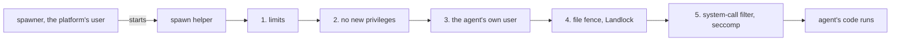

# 8. The sandbox

## The hotel

Think of the agents as guests in a hotel, and the platform as the
hotel's staff.

- **Every guest gets a room of their own.** Their key opens their room
  and nothing else — not another guest's room, not the office, not the
  safe.
- **There is one front desk for calls to the outside world.** A guest
  who wants to reach someone outside asks the desk, and the desk
  connects them only to the people on that guest's list, a list the
  manager read and signed when the guest checked in.
- **Some things nobody may do in the building at all** — pick a lock,
  read another guest's mail, take the wiring apart — whatever room they
  are in.
- **The guests stay in a wing of their own**, away from the staff and
  the safe. A guest who sets a fire burns their wing, not the office.
- **Each morning an inspector walks the building** and writes down
  plainly which locks work today. If the doors cannot be locked at all,
  the hotel does not open.

That is the sandbox. An agent's code is a guest the platform does not
trust: it may have been written carelessly, or written to do harm, or
taken over by something it read. The sandbox makes four promises about
it, and keeps a fifth underneath them:

1. **It reads and writes only its own files.**
2. **It runs as its own user**, and can stop no one else's programs.
3. **It reaches only the hosts its manifest named**, and an
   administrator approved.
4. **It uses no more than the platform allows.**
5. And beneath all four: **it may not ask the computer's core for the
   things escapes are made of.**

## In the example

The mail agent from our request — the one that sends the reminder
emails — declared one host, `gmail.googleapis.com`. When the assistant
asks it to send, its code runs:

- as a user that exists only for the mail agent;
- able to open its own package, its own installed libraries, and a
  home folder that was emptied when its process started — and no other
  agent's files;
- able to connect to one place, the platform's proxy, which lets it
  through to Google's mail service and nowhere else;
- holding your mail credential because the platform handed it over for
  this call — the model never saw it.

If the mail agent's code were malicious, it could misuse the mailbox it
was lent — that is what reviewing an agent before approving it is for —
but it could not read the spreadsheet agent's files, reach any other
website, or touch the platform.

## The rooms are built in layers

Each promise is kept by a separate mechanism, so that a gap in one is
not a gap in all. They are applied in a fixed order every time an
agent's process starts. The spawner, running as the platform's own
user, starts a small spawn helper. The helper (1) sets limits on
processes, open files and file size; (2) gives up the right to gain
privileges; (3) becomes the agent's own user; (4) puts up the file
fence (Landlock); (5) applies the system-call filter (seccomp). Only
then does the agent's code run.

And around all of it, the whole thing happens in a container of the
agents' own, whose network leads to the platform's proxy and nowhere
else.

| Promise | What keeps it |
|---|---|
| its own files | a user of its own, and a file fence the kernel enforces |
| its own user | a small program that switches users and then cannot switch back |
| only declared hosts | the proxy, a firewall rule that leaves the proxy as the only way out, and a network that leads nowhere else |
| no more than allowed | limits set before the code starts, and a watcher that ends the largest agent before memory runs out |
| no dangerous system calls | a filter the kernel applies, which nothing can lift once set |

## The inspector

A sandbox you cannot see is a sandbox you have to take on faith. So
every time the platform starts, before it serves anyone, it tests its
own locks: it starts a process as an agent's user, asks the kernel what
fences it can enforce, prepares a room from end to end, and tries to
reach the network the way an agent would. It writes down what it found
in plain words — *Workers are confined*, *Workers' files are fenced*,
*Workers' system calls are filtered* — or that one of them is not, and
why.

Two things follow from what it finds.

- **If agents cannot be confined at all, the platform does not start.**
  There is no "run without the sandbox" switch. Only the test suite
  starts agents' code without the agents' container, through a
  stand-in that exists in the tests and nowhere else.
- **If one lock is weaker on this machine** — an older Linux kernel
  that cannot fence files, say — the platform runs, and every agent's
  page says, in a sentence, what is not enforced where it runs. A
  person deciding whether to trust an agent reads the truth about this
  installation, not about an ideal one.

## What the sandbox does not do

It is as important to say what it does not do.

- **It separates agents, not the people of one organization.** One
  process of the mail agent serves everyone in the organization who was
  given it. The organization's decision to approve an agent is the line
  the sandbox holds.
- **It does not stop an agent misusing what it was rightly given.** The
  mail agent holds your mail credential during a call, and since its
  process is kept running between calls, code that wanted to could
  keep it. What it does with your mailbox is its own doing; reading its
  manifest and code before approving is the answer to that.
- **It does not replace the container,** and containers on one machine
  share the machine's kernel. A flaw in the kernel itself is a way past
  all of it. The system-call filter exists to make such flaws harder to
  reach, not impossible.

[Section 11](11-what-it-does-not-do.md) gathers these with every other limit the paper states.

<b>For the specialist</b>: the mechanism, in order, with sources

### Topology

Agent code runs only in the **agents' container**: the runtime's image
started with another command, sharing one volume at one path
(`ai_runtime/agents_container/`). Its one platform process, the
**spawner** (`service.py`), takes structured requests from the runtime
over a socket (`wire.py`), authenticated by a key it generated at first
start and left on the volume readable by the platform's user and no
agent's. It starts workers, builds requirements, lists and ends — and
carries a worker's protocol lines without reading them; what a worker
is entitled to is decided by the runtime and never told to the worker.
The runtime never sees a pid, a uid or a command line.

The container's network is internal and reaches the runtime only: no
route to the internet, the database or the backend. A worker whose
runtime hung up is ended with everything its user runs. The container
is handed no secret of the platform's — the proxy's address and port,
the install folder, the syscall-filter switch, log level and time zone,
nothing else (`docker-compose.yml`, service `agents`).

There is no unconfined path. A runtime with no `AI_RUNTIME_AGENTS_SPAWNER`,
or whose spawner does not answer or cannot confine, raises
`ConfinementFailed` and does not start (`ai_runtime/agents/confinement.py`,
`Confinement.start`; `ai_runtime/agents_container/places.py`,
`Places.check`).

### The spawn helper

`ai_runtime/agents_container/spawn_helper.c`, a few hundred lines of C
compiled into the image (the compiler is removed again), owned
`root:decentai`, mode `0750`, so only the runtime's group may run it.
It is not setuid-root: the file carries exactly the four capabilities
its jobs need, `cap_setuid`, `cap_setgid`, `cap_chown` and
`cap_fowner` (`ai_runtime/Dockerfile`). A compiled program, because
file capabilities are honoured on a binary and not on a script. It is
exec'd in place of the worker, on the same pipes, and in this order:

1. **Refuses** a caller that is not the platform's user, a target uid
   outside the range reserved for workers, and a home not owned by
   that uid (checked with `fstat` on the opened folder).
2. **`setrlimit`**: `RLIMIT_NPROC` 2048 (per uid, so per agent),
   `RLIMIT_NOFILE` 4096, `RLIMIT_FSIZE` 1 GiB, `RLIMIT_CORE` 0
   (`Places.MAX_PROCESSES` etc.). `umask 0007`.
3. **`prctl(PR_SET_NO_NEW_PRIVS)`** — for itself and every descendant.
   This is what makes a privileged binary safe to leave on the
   worker's path: under `no_new_privs` an exec grants no file
   capabilities, so a worker that runs the helper gains nothing.
4. **`setgroups(0)`, `setresgid`, `setresuid`** to the agent's ids,
   then **`capset` to the empty set**: no capability survives into the
   worker, and there is no way back.
5. **Landlock** (`landlock_restrict_self`), applied *after* the uid
   switch, at the ABI the kernel offers.
6. **seccomp** (`SECCOMP_SET_MODE_FILTER`), applied last, so the
   helper's own remaining work needs nothing the filter refuses.
7. `execve` the worker.

CPU time is deliberately not limited by `RLIMIT_CPU`: it counts a
process's whole life, and workers are kept warm across calls. Each call
is bounded by the runtime's clock instead.

Four further subcommands need the same privilege: `own` (chown a home
or spool to its user), `clear` (empty one *as its owner*, so nothing
but that user's is deleted; a closed or deeply nested folder is opened
to its owner and lifted, and a clear that leaves anything refuses the
start), `stop` (kill every process of a uid — so a browser never
outlives the worker that started it), and `sweep` (delete what a uid
left in world-writable folders, `/tmp` and `/dev/shm`, before every
start and after every stop).

**Why not namespaces.** Inside a container's default profile a process
cannot create user namespaces; permitting it means relaxing the
container's own seccomp profile, which weakens the container for
everything in it. Separate uids, Landlock and a seccomp filter give
the isolation without that cost.

**One uid per approval.** The pool keeps one worker per approved agent,
and each approval gets a uid from the range; the table lives beside the
store (`<install_dir>/workers/users.json`). The first uid of the range
is reserved for verifying packages (an import of code that is nobody's
approved agent yet), the last for the builder. A home is emptied before
every start: a worker holds no state between starts, and cannot keep
some by closing a folder or nesting it deep. Places unused for thirty
days are given up, uid included.

### Files: Landlock

The spawner names the paths; the helper hands them to the kernel after
becoming the agent's user. Read-and-execute: the system directories,
the image's browsers, the agent's own package and environment.
Read-write: its home and spool. Write where ownership still decides:
`/dev`, `/proc`, `/tmp` (a browser insists on its lock in `/tmp`).
Nothing else: the platform's code, other agents' packages and
environments, the uid table. `/tmp` and `/dev/shm` stay writable to
every worker, with ownership deciding as anywhere else: a worker's
files there are closed to other users, and swept before every start
and after every stop, but two agents that both *mean* to can pass
bytes through a file one of them opens to the other — on any kernel. The helper validates none of the paths:
a Landlock ruleset can only remove access, so whoever asks ends with
less.

The ruleset requests what the running kernel's ABI supports, learned
at start:

| ABI | Kernel | Adds |
|---|---|---|
| 1 | 5.13 | path-based access |
| 2 | 5.19 | `REFER`: moving a file between its own folders |
| 3 | 6.2 | `TRUNCATE` |
| 4 | 6.7 | TCP connect restricted to the proxy's port |
| 6 | 6.12 | abstract unix sockets scoped to the worker's own domain |

The last row closes a channel that ownership and the firewall both
miss. An **abstract unix socket** has a name and no inode: no owner, no
mode, and it is invisible to an address-based firewall rule. All
agents share one container, so without scoping, two colluding agents —
one that may read your files and connects nowhere, one that may connect
anywhere — could pass bytes over one. From ABI 6 a fenced worker
connects only to abstract sockets created inside its own Landlock
domain. On older kernels the gap is stated at start and listed in the
limits.

The TCP rule (ABI 4) is a second hold behind the firewall, not the
first: it names a port, not an address, and does not cover DNS.

### System calls: seccomp

A denylist, not an allowlist, on purpose: an agent may bring any
Python package, and an allowlist would be a list of what somebody
forgot. Refused, for the worker and all its descendants:

| Class | Calls | Why |
|---|---|---|
| namespaces and mounts | `unshare` and `clone` with namespace flags, `setns`, `mount`, `umount2`, `pivot_root`, the new mount API | most container escapes begin by creating a namespace |
| cross-process memory | `ptrace`, `process_vm_readv`, `process_vm_writev`, `pidfd_getfd` | a worker's processes need no such door |
| large kernel surface | `bpf`, `perf_event_open`, `userfaultfd`, `io_uring_*`, module and kexec loading, keyring calls, `open_by_handle_at` | where kernel flaws are found |
| socket families | all but `AF_UNIX`, `AF_INET`, `AF_INET6`, and netlink for routes and links only | each family is more kernel to reach |

`clone3` returns `ENOSYS` rather than `EPERM`: its flags sit behind a
pointer a BPF filter cannot dereference, and glibc, told the call does
not exist, falls back to `clone`, whose flags the filter can inspect.
Threads and `fork` work as before. Refusals return the errno programs
already handle (`EPERM`, or `EAFNOSUPPORT` for a socket family), so a
package that probes one degrades instead of crashing.

The filter is independent of the container engine's own profile: it is
the same under Docker, Podman or none, and refuses what Docker's
default allows (`ptrace` among it). The image's Chromium launches,
loads a page, runs script and screenshots under it. It is written for
x86-64 and arm64; elsewhere there is none, and the spawner says so.
`AI_RUNTIME_SYSCALL_FILTER=0` turns it off, for an agent whose package
needs a refused call, and the spawner says that at every start.

### Packages: the builder

A source distribution's build is arbitrary code. So installing a
manifest's dependencies is split between two users:

1. **The builder**, the range's last uid in a place of its own, under
   the same limits and fences, downloads and builds the declared list
   into wheels in its spool. Its proxy pass opens `pypi.org` and
   `files.pythonhosted.org` and nothing else (a deployment with its own
   index names it). A requirement that begins as an option (`-r`,
   `--index-url`) is refused before pip starts; no pip configuration
   file is read; nothing persists between builds; one build runs at a
   time and is killed after five minutes.
2. **The runtime** unpacks the wheels into the environment. It is
   handed files, never the list; it resolves and downloads nothing;
   unpacking a wheel runs none of the package's code. From the spool it
   takes only regular files with a wheel's name; links are not
   followed.

Packages a person allowed for one run of code (`call.install`) go
through the same builder into a per-list folder inside the agent's
environment; the requesting code never reaches the package index.

### Network: the proxy, the rule, the hosts

The manifest's `network.hosts` is required (a manifest without the
block is refused): DNS names or a leading wildcard, a port only for a
protocol that is not the web's, `from_secret` for a host read from a
plain (never encrypted) field of the granted credential, `[]` for
nothing, `any` for the open web. Internal addresses — loopback, the
private ranges, link-local where cloud metadata lives — are refused to
every agent, `any` included.

The proxy (`ai_runtime/agents/egress.py`):

1. identifies the worker by a per-worker pass, and serves no one else;
2. refuses a host the manifest does not name;
3. **resolves the name itself, and refuses the host if any answer is
   internal** — it does not pick the safe address, because which
   address a client would use is not its choice; this closes DNS
   rebinding toward the platform;
4. connects to the address it checked, and copies bytes both ways.

It sees host and port only; it terminates no TLS and installs no
certificate. Bounds: 128 open connections per worker, 1,024 in all;
256 connections that have not yet identified themselves, each with 30
seconds and 64 KiB to do it, the oldest silent one closed first; 30
minutes idle. A refusal is written where a client shows it — the
`CONNECT` response line — naming the agent and the host.

A host named by a credential (`from_secret`) or by a code card a person
allowed is **lent** to the worker's pass from the moment the call is
handed it until that call ends, reference-counted across concurrent
calls. Every connection made or refused is recorded with whose it was,
where, bytes each way and duration ([monitoring](../system/monitoring.md)).

The proxy is enforceable only because nothing else is reachable.
`ai_runtime/start.sh` runs as root once at container start and installs
an nftables rule on the output hook matching the *socket owner's uid*
over the whole worker range (`meta skuid 20000-29999`): accept TCP to
the proxy's port on `127.0.0.1`, reject everything else — other ports,
other agents, the spawner, the internet, DNS. It then `exec`s the
platform's process through `setpriv`, as the platform's user, with
`net_admin` removed from the bounding set, so nothing it will ever
start can change the rule. Where the container was not given
the capability, the stack starts and the spawner proves the result by
trying, as a worker would, to reach a port only the rule protects.

### Memory

A per-process address-space limit breaks browsers, so the agents are
given memory together (`AGENTS_MEMORY`, `AGENTS_CPUS`). Memory cannot
be throttled, only refused, and the kernel's OOM killer picks its own
victim. So the spawner samples each agent's unique memory (what its
uid's processes hold that is theirs alone; shared pages are charged to
no one) every second, and at 90% of the container's limit ends the
largest agent with all it runs (`agents_container/usage.py`,
`ENDS_AT = 0.9`; `SpawnerService._end_largest_agent`). The call that
agent was serving is told why, in words, with the numbers.

### How it is tested

`ai_runtime/tests/test_confinement_live.py` runs, inside the runtime's
image, a fixture agent that is hostile on purpose. Each function tries
one escape, and the test passes when it is refused: read the runtime's
settings; signal the runtime; write into the store; read another
agent's home; open an unused socket family; `ptrace`; create a
namespace (while a thread and a subprocess still start); connect past
the proxy; connect to an undeclared host; connect to the backend; fork
past the process limit; re-exec the helper; connect to another agent's
abstract socket. A package hostile *at build time*, served from a local
index, reads no settings, writes nothing into the environment, reaches
the index and nothing else, and is killed when it does not finish.
`ai_runtime/tests/test_spawner_live.py` runs the same agent across the
two real containers.

### Stated limits

Per-person isolation inside an agent; misuse of rightly granted
secrets and hosts; the shared kernel; a channel between two agents
that both mean to collude, through a file in `/tmp` or `/dev/shm`
(any kernel) or an abstract socket (before Linux 6.12); memory as a shared pool with a
one-second sampling window; disk counted (every 30 s) but not capped;
a package's `.pth` line running as the worker; process listing within the container (never the runtime's,
which is another container); no loopback between a worker's own
processes. Each is in [the sandbox's own page](../system/sandbox.md#what-the-sandbox-does-not-do).

