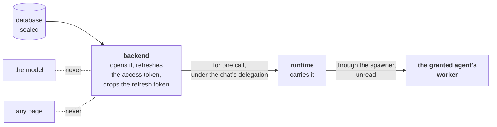

# 9. Secrets and data

## The vault and its counter

Think of a bank vault with one counter in front of it.

- **Every box looks the same.** It has a label on the outside —
  *"Google account, dana@example.com"* — and sealed contents the label
  never shows: the password, the token, the private notes.
- **The list you are shown is already filtered.** The clerk does not
  fetch box 4417 and then wonder whether it is yours. The list starts
  from what you may see, and asking for a box you may not see gets the
  same answer as asking for one that does not exist.
- **Only the clerk holds the keys.** Not the courier, not the guests in
  the hotel of [section 8](08-the-sandbox.md), not the untrusted assistant of [section 2](02-the-idea.md).
- **A box can be lent, not handed over.** You can tell the clerk that
  one guest may use one box. When that guest needs it for one job, a
  courier carries the opened contents to that guest's room for that
  job, and the assistant never touches it.

That is how DecentAI keeps what people own: credentials, uploaded
files, notes for the assistant, and the records agents keep for them.
One shape for all of it, one filter on every read, one set of keys,
held by one part of the platform.

## In the example

> *"Email the three customers whose invoices are overdue, and remind me
> on Friday if any of them hasn't paid."*

Long before this request, the person connected their Google account
once: they pressed *Connect*, Google asked them to allow it, and the
platform kept what Google gave back — an **access token**, a pass that
works for about an hour, and a **refresh token**, which can mint new
access tokens for as long as the person allows.

When the mail agent sends the first email, its code asks the platform
for its credential. The **backend**, which holds the keys, opens the
box, makes sure the access token is still fresh, and hands back the
account name and the access token — not the refresh token. The
**runtime** carries that to the mail agent's process for this one call,
and the agent sends the email with it.

The model that planned the emails saw none of this. It never had the
token, so no email it reads can talk it into giving the token away.

## One shape for everything stored

A credential, a file, a skill and an agent's record could each have
been built with their own rules — which is how one of them ends up
missing a check the others make. So every stored thing is the same
document, and the rules that matter are written once:

| Part | What it is | The Google account |
|---|---|---|
| **reference** | the one name for this document | a long random id |
| **category** | a label many documents share | the mail agent's credential slot |
| **owner map** | who may see it: some groups, some people | just Dana |
| **keys** | plain, searchable facts | provider, account, when the token expires |
| **values** | the sealed part | the access token and the refresh token |

Keys can be searched and shown in a list; values cannot be searched at
all, because they are sealed. A credential puts its account in keys,
so a person can tell two apart, and its token in values, so no page can
show it.

## Seeing is a filter, not a check

There are two ways to keep people out of what is not theirs: fetch the
thing and then ask *"may this person have it?"*, or write the question
into the search itself, so the search cannot find what the person may
not see. DecentAI does the second, on every read served to anyone: *in
this person's organization, of this kind, shared with this person or
one of their groups*. A check after a lookup is a line somebody can
forget; a filter inside the lookup is one they would have to remove.

## Seeing is not changing

Every stored thing has one **steward**, the person who made it, and
only the steward may change it, share it further, hand it on or delete
it. A colleague a credential was shared with may *use* it, not edit it.
And nobody may share further than they reach: only into groups they
belong to, and with people who share one of those groups. Otherwise
anyone could publish their things into a group they are not in.

For each kind of thing there is one named **escape grant** — *maintain
credentials made by others*, *maintain files made by others*, and so on
— that lifts both rules for an administrator, for that kind only, and
only over things the holder can already see. When a person leaves,
what they kept is handed to a successor, not deleted.

## Each agent keeps to its own shelf

An agent may keep records and files — a note of which reminders it
sent, a report it made — in **slots**, one per resource its manifest
declared, named after the agent's approval and the resource:
`agt_<approval>__<resource>`. The agent never writes this name. The
runtime writes it on every request, from the agent that is actually
running, so a record under any other slot — another agent's, or the
person's own notes — answers as if it did not exist. The records are
still the person's: they can read and delete them, and uninstalling the
agent leaves them in place.

## What is sealed, and with what

Everything in the values half is encrypted before it reaches the
database, with a standard, well-studied cipher (AES-256-GCM).

- **A sealed value belongs to its document.** The document's reference
  is mixed into the seal, so a value copied into another document does
  not open there.
- **Keys can be replaced without losing anything.** Each value records
  which key sealed it. A new key is added, everything is resealed with
  it, and only then is the old one retired.

If a value cannot be opened — its key is missing — a page still shows
everything else and marks that one unreadable, never empty; an agent
asking for a credential gets an error, never an empty password.

A credential's sealed half is **never shown back to a person**, by any
page, under any permission. They can see the provider, the host and the
account; to change a password, they type a new one.

## The path a secret travels



A decrypted secret exists in the backend, which opens it; in the
runtime, which carries it for one call; and in the worker of the agent
it was granted to. On the way it passes through the spawner of
[section 8](08-the-sandbox.md), which relays the line without reading it. It is never put in front
of the model and never sent to a page.

## Lending, and taking back

Two agents may need the same account — a mail agent and a calendar
agent, both for Dana's Google account. Instead of signing in twice, the
person **lends** the credential to the second agent's slot. A loan is
offered only where the shapes match exactly, and for a connected
account only for the same provider and permissions the person already
agreed to. It can be taken back at any time, and a lent credential
cannot be deleted out from under its agents: the platform refuses, and
names them, unless the person asks for the loans to be taken back
first.

## Connected accounts, and the phone

The platform, not the agent, runs the sign-in, keeps the tokens and
refreshes them. The refresh token never leaves the backend; neither
does the secret the organization's app was registered with.

On a phone, the sign-in runs in the phone's browser, which does not
carry the app's session. So the browser hands the app a one-use ticket
that lives two minutes, and the app finishes the connection with its
own session. A ticket that reaches somebody else connects nothing.

## Files and records

A file's stored name is computed from its bytes, its name, its folder
and its description, so the same file uploaded twice by one person is
one file. Its bytes are never changed — a rename changes the
description — and are deleted only when the last document pointing at
them goes. When an agent updates a record it sends only the fields that
changed, and the rest are kept: "mark it paid" does not erase the
invoice number.

## What a captured runtime could see

The runtime holds none of the vault's keys, and acts for a person only
through a chat's delegation, which lasts an hour and is renewed while
the chat stays connected ([section 4](04-who-you-are.md)). If it were taken over, it could
read what is visible to each person whose delegation it still holds —
their credentials included — and nothing of anybody else's. It could not
read the database, open a sealed value itself, or obtain a refresh
token.

## What it does not do

- **It does not stop an agent misusing a credential it was lent.** And
  an agent that put the token into its result would pass it on: results
  are checked against the manifest's schema, not searched for secrets.
- **It does not take the token back from the agent's memory.** The
  runtime forgets it after the call; the agent's process is kept warm
  between calls, and code that wanted to could keep it.
- **It does not seal a file's bytes on disk.** Their description is
  sealed; the bytes are stored as they are, where only the backend
  reaches.
- **It does not separate the people of one organization inside one
  agent** ([section 8](08-the-sandbox.md)).

[Section 11](11-what-it-does-not-do.md) gathers these with every other limit the paper states.

<details>
<summary><b>For the specialist</b>: the mechanism, in order, with sources</summary>

### The document and the filter

Every data-layer store is a `ResourceStore`
(`backend/database/stores/data/resources.py`), with controllers in
`backend/api/services/data_layer/`. `_id` (served as `resource_ref`) is
`uuid4().hex`; `resource_id` is the category (a secret's definition
family; `agt_<ref>__<slot>` for an agent's record; for a file, the
content id of its bytes, with its slot in `keys.category`). `keys` holds
≤ 50 scalars, text ≤ 8,192 characters; `values` ≤ 50 entries, each
≤ 4 Mi characters and ≤ 10 Mi in all before encryption. An approval ref
is `agt_` plus 20 hex characters.

Every read served to a caller (`list_visible`, `get_visible`,
`visible_doc`, `use`) is one query carrying the id and this filter
(`Sharing.visibility_filter`, `backend/server/governance/sharing.py`,
plus `type`):

```
{ type, org_id: <reader's org>,
  $or: [ {owner.groups: {$in: reader's groups ∪ {Everyone}}},
         {owner.users: <reader's id>} ] }
```

`Everyone` is a sentinel read beside the reader's own `org_id`, so an
organization-wide share cannot cross a tenant. A miss is the same 404
as a document that does not exist. Lookups by id alone are the
platform's own work inside one request: the OAuth callback finding the
credential it reconnects, a transfer, counting references to a file's
bytes, and reading back a write.

**Writing an owner** (`ResourceController._owner_or_refusal`,
`backend/api/services/data_layer/base.py`): every id must exist in the
caller's organization; then, without the escape action, each group
must be one of the caller's explicit groups (Everyone refused) and each
person must share one (`Sharing.beyond_reach`). **Changing** is
`Sharing.may_edit`: `created_by` is the caller, or the caller holds
`secrets:secret:set_owner_any`, `files:file:set_owner_any`,
`data:record:set_owner_any` or `skills:skill:set_owner_any`. It runs on
a document already found through the caller's filter, so the escape
reaches only what its holder sees
([sharing](../system/sharing.md#the-escape-grant)).

**Slots.** `ResourceAccess` (`ai_runtime/execution/resources.py`) is
built per invocation with `namespace` set by the executor to the
running agent's id; only declared ids and operations answer, and each id
becomes `<namespace>__<id>`. `ChatResources`
(`ai_runtime/door/platform.py`) sends it as `resource_id` on list and
create and as `slot` on every call by reference; the backend's
`_outside_slot` answers 404 when a runtime principal's `slot` is not
the document's category. A ref the call was *handed* is read with no
slot, never written; which strings count as handed is broader than the
docs suggest ([open questions](../contributing/open-questions.md),
EXE-12).

### Encryption at rest

`SecretCipher` (`backend/database/crypto.py`), on the `cryptography`
package's `AESGCM`:

- **Key**: 32 bytes, from `SECRET_ENCRYPTION_KEYS` as comma-separated
  `<version>:<urlsafe base64>`. Used as given; no derivation. Versions
  are compared as text, so mixed widths are refused at load; the
  generator writes `01`, `02`. Active: `SECRET_ENCRYPTION_ACTIVE`, or
  the highest.
- **Nonce**: 12 bytes from `os.urandom`, fresh per encryption. Every
  write re-encrypts the whole map. With random 96-bit nonces the usual
  limit on encryptions per key applies (NIST SP 800-38D); rotation
  resets it.
- **Plaintext**: the `values` map as compact JSON, UTF-8.
  **Associated data**: the document's `_id`, UTF-8 — not the owner,
  which changes on share and transfer.
- **Stored**: `{alg: "aes-256-gcm", key_version, nonce, ciphertext}`,
  base64, the 16-byte tag appended to the ciphertext.
- **Decryption** raises `SecretCipherError` on another `alg`, an
  unconfigured version, a failed tag, or a payload that is not a JSON
  object. It never returns part of a map.

The same cipher seals a model connection's key, an OAuth app's client
secret and a source's git token; each store names its fields in
`ENCRYPTED_FIELDS`. With no keys set, the backend does not start; nor
does it with the example settings' `01:change-me`, which decodes to
too few bytes (`SecretCipher.verify`). It never derives a key from
another setting.

**Not sealed**: `keys`, by design; a file's bytes, written as they are
under the connector's root (`backend/database/file_connectors/local.py`);
the OAuth state rows below.

**Unreadable.** For display, `_readable_values` returns an empty map
and a flag, served as `unreadable`. An edit to an agent's record whose
values cannot be read is refused with 409, so nothing overwrites them
(`backend/api/services/data_layer/records.py`). For use,
`Secrets:Secret:Use` answers 409 with the cipher's sentence.

**Rotation** ([operating](../run/operating.md#rotating-the-encryption-key)):
`bootstrap/generate_secret_keys.py --rotate` appends the next version;
the operator activates it and restarts; `bootstrap/reencrypt_secrets.py`
walks every store's `ENCRYPTED_FIELDS`, re-encrypts each blob whose
`key_version` is not active with an update conditioned on the old
version, and reports any it could not open. The old key may go when
nothing is left. The tool asks for the backend to be stopped or idle.

### A secret's road, in order

1. Agent code calls `call.resources.use_secret(resource_id, ref=None)`
   (`decentai_sdk/worker.py`): a protocol line, through the spawner.
2. `Call.resource` (`ai_runtime/execution/call.py`) hands it to
   `ResourceAccess.use_secret`: the function must declare
   `secrets.<id>:use`; the category becomes `agt_<ref>__<id>`.
3. `ChatResources.use_secret` posts `Secrets:Secret:Use` to the
   backend's `/app` gateway under the chat's delegation.
4. `SecretController.use` (`backend/api/services/data_layer/secrets.py`)
   refuses any principal but the runtime. A category resolves in order:
   the chat's binding, the grant on this slot, the person's default,
   the only visible credential; otherwise 404 or 409, never a guess.
   Each candidate is re-read through the person's filter. A ref named
   with a category must be under the slot's family or granted to it.
5. The values are decrypted (`ResourceStore.use`), or, for a connected
   account, come from `OauthFlow.fresh`. A credential older than the
   agent's shape that lacks a newly required field is refused (`_behind`).
6. `secret.use` goes on the audit trail with the chat and the ref,
   never values. The answer `{keys, values}` is merged into one map.
7. A `from_secret` host is lent to the worker's proxy pass until the
   call ends ([section 8](08-the-sandbox.md)); the map returns to the worker.

The runtime keeps nothing past the call. Nothing stops an agent from
returning the value, which then reaches the model and the trail (open
questions EX-6, EXE-11). A login asked for mid-call (`call.credential`)
is typed on a card, saved by the backend, and handed out only through
`Secrets:Credential:Resolve` — runtime-only, audited the same way, for
agent and site pairs the person consented to
(`backend/api/services/data_layer/credentials.py`).

### Grants and take-back

`AgentSecretGrantStore` (`backend/database/stores/agents/grants.py`)
keeps one row per organization and slot, naming the credential; a new
grant replaces the old. The granter must see the credential; shapes
must match exactly (name, type, storage, required, options); a
connected account needs the same provider and every scope the slot
declares (`backend/api/endpoints/app/agents/secret_grants_controller.py`).
The row is organization-wide, but at use the credential is re-read
through the chatting person's filter, so a grant lends nothing to
someone who cannot see it. Deleting a granted credential answers 409,
naming the agents, unless its steward or an escape holder sends
`take_back: true`: grants go, then the credential, then unused
definition versions. Uninstalling an agent deletes its grants and keeps
its records and files.

### Connected accounts

`OauthFlow` (`backend/api/services/oauth.py`); `OauthAppStore` and
`OauthStateStore` (`backend/database/stores/settings/oauth.py`).

- **Start.** A `token_urlsafe(32)` state, stored as its SHA-256, names
  the person, the browser session, the definition and a PKCE verifier
  (`token_urlsafe(64)`, `S256`); 10 minutes. The manifest's authorize,
  token and identity addresses must equal the organization's
  registration, or nothing is sent.
- **Callback** (`backend/server/routes/oauth.py`). The state is spent
  with `find_one_and_delete`, and refused unless the same person is
  signed in, in the session the flow recorded. The code is exchanged
  with the verifier, the account read, the credential created — or
  updated, if the person already connected that account.
- **Phone.** The callback parks the code behind a second
  `token_urlsafe(32)` hand-off, stored as SHA-256, 2 minutes, sent to
  `decentai://oauth` or the app's non-web `return_to`.
  `Secrets:Oauth:Complete` takes it under the app's own session;
  another person or session is refused and spends nothing, so a
  hand-off caught by another app is useless. State and hand-off rows
  are not encrypted; they hold the verifier and code for at most 10
  and 2 minutes.
- **Stored**: `account`, `expires_at`, `status` in keys;
  `access_token`, `refresh_token` in values.
- **At use** (`fresh`): a token good for more than 60 more seconds goes
  out with `refresh_token` removed (`_for_agent`); otherwise the backend
  refreshes, saves (55 minutes when no lifetime is given) and hands out
  the new one. No refresh token, or a refusal, marks the credential
  `needs_reconnect` and the agent is told in words.

### What a runtime holds

No key of the vault, no database
([architecture](../system/architecture.md#who-is-trusted-with-what)).
Through open chats' delegations it can call `Secrets:Secret:Use` with a
bare `resource_ref`, checked only against the person's visibility. A
runtime taken over could therefore read every credential, record and
file visible to each person whose delegation it still holds — access
tokens included; refresh tokens and client secrets never leave the
backend.

Tests: `backend/tests/test_data_layer.py`,
`backend/tests/test_runtime_secret_use.py`,
`backend/tests/test_agent_secret_grants.py`,
`backend/tests/test_oauth.py`, `backend/tests/test_files.py`.

</details>
